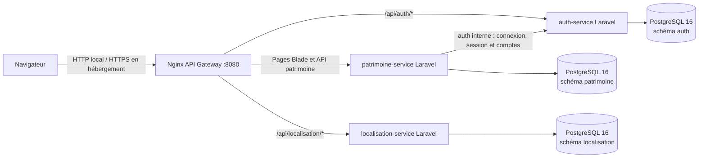

# Gestion du Patrimoine de l’État (GPE)

Application web de démonstration pour enregistrer et consulter le patrimoine mobilier de l’État. Le projet est un MVP pédagogique en architecture microservices, avec Laravel, PostgreSQL, Docker et Nginx.

> **État du projet :** démo locale fonctionnelle. Les services et les écrans livrés sont décrits ci-dessous. Le déploiement public durable, l’authentification sur toutes les opérations métier et plusieurs fonctions du besoin cible restent à réaliser.

## Sommaire

- [Fonctionnalités](#fonctionnalités)
- [Architecture](#architecture)
- [Technologies](#technologies)
- [Démarrage local](#démarrage-local)
- [Créer le premier administrateur](#créer-le-premier-administrateur)
- [Structure du dépôt](#structure-du-dépôt)
- [Données et normalisation](#données-et-normalisation)
- [Sécurité et limites connues](#sécurité-et-limites-connues)
- [Documentation du projet](#documentation-du-projet)
- [Branches et contributions](#branches-et-contributions)

## Fonctionnalités

| Module | État dans le MVP |
|---|---|
| Tableau de bord | Indicateurs globaux, derniers biens, aperçu des notifications |
| Biens | Liste paginée, création, consultation, modification, suppression et génération du code `GPE-xxxxxx` |
| Sites | Gestion des sites, codes SITE-XX générés automatiquement |
| Utilisateurs | Connexion administrateur, liste, création, modification, rôle `admin`/`agent`, activation et désactivation |
| Notifications | Enregistrement PostgreSQL lors de certains événements, consultation et marquage comme lu |
| Rapports | Totaux agrégés et aperçu imprimable |
| Affectations | Routes API de base dans le service localisation ; parcours utilisateur complet à développer |
| Inventaires physiques, pièces jointes et amortissement | Besoin cible, pas encore disponibles dans le MVP |

L’interface des utilisateurs utilise le vrai service d’authentification. Le compte désactivé ne peut plus ouvrir de session et ses jetons existants sont révoqués. Le dernier administrateur actif ne peut pas être retiré ou désactivé.

## Architecture



Les schémas PostgreSQL séparent logiquement les domaines (`auth`, `patrimoine`, `localisation`). Les services utilisent toutefois le même serveur PostgreSQL et les mêmes identifiants de connexion : les schémas ne constituent donc pas une isolation de sécurité entre services.

## Technologies

- PHP 8.4 dans les images Docker ; les projets Laravel déclarent PHP `^8.3`.
- Laravel `^13.17` dans les trois services.
- PostgreSQL 16, schémas `auth`, `patrimoine` et `localisation`.
- Blade, Tailwind CSS 4, Vite 8.
- Nginx comme passerelle HTTP.
- Docker Compose pour l’environnement local.
- PlantUML pour les diagrammes UML.

## Démarrage local

### Prérequis

- Docker Desktop avec le moteur Linux démarré.
- Git.
- Node.js et npm pour compiler les ressources CSS/JS.

PHP et Composer sont exécutés dans les conteneurs ; ils n’ont pas besoin d’être installés sur Windows.

### Installation

Depuis PowerShell :

```powershell
git clone <URL_DU_DEPOT>
Set-Location gestion-patrimoine-etat
```

Créer les fichiers d’environnement locaux si le dépôt est neuf :

```powershell
Copy-Item services/auth/.env.example services/auth/.env
Copy-Item services/patrimoine/.env.example services/patrimoine/.env
Copy-Item services/localisation/.env.example services/localisation/.env
```

Dans chacun des trois fichiers `.env`, utiliser les paramètres PostgreSQL du Compose local :

```dotenv
APP_ENV=local
APP_DEBUG=true
DB_CONNECTION=pgsql
DB_HOST=postgres
DB_PORT=5432
DB_DATABASE=patrimoine
DB_USERNAME=patrimoine
DB_PASSWORD=secret
```

Dans `services/patrimoine/.env`, ajouter également :

```dotenv
AUTH_SERVICE_URL=http://auth-service:80
SESSION_DRIVER=file
```

Générer une clé Laravel par service, démarrer les conteneurs et initialiser les migrations :

```powershell
docker compose up --build -d
docker exec -w /var/www gpe-auth php artisan key:generate
docker exec -w /var/www gpe-patrimoine php artisan key:generate
docker exec -w /var/www gpe-localisation php artisan key:generate
docker exec -w /var/www gpe-auth php artisan migrate --force
docker exec -w /var/www gpe-patrimoine php artisan migrate --force
```

Compiler l’interface :

```powershell
Set-Location services/patrimoine
npm install
npm run build
Set-Location ../..
```

Vérifier l’état des services :

```powershell
docker compose ps
```

Puis ouvrir [http://localhost:8080](http://localhost:8080). L’application est servie par la passerelle Nginx sur le port `8080`.

### Commandes utiles

```powershell
docker compose logs --tail 100 patrimoine-service auth-service
docker compose restart patrimoine-service auth-service
docker exec -w /var/www gpe-patrimoine php artisan optimize:clear
docker compose down
```

`docker compose down` conserve le volume PostgreSQL. **Éviter `docker compose down -v`** : cette commande supprime également les volumes et les données locales.

## Créer le premier administrateur

La commande pose les questions dans le terminal et ne définit aucun mot de passe par défaut :

```powershell
docker exec -it -w /var/www gpe-auth php artisan admin:create
```

Choisir un mot de passe d’au moins 12 caractères et le confirmer. Se connecter ensuite sur [http://localhost:8080/connexion](http://localhost:8080/connexion).

## Structure du dépôt

```text
db/init/                 Schémas et tables PostgreSQL initiaux
gateway/nginx.conf       Routage Nginx vers les services
docs/analyse/            Analyse du besoin
docs/figma/              Charte et spécification des maquettes
docs/uml/                Diagrammes PlantUML
services/auth/           Connexion, jetons et gestion des utilisateurs
services/patrimoine/     Interface web, biens, notifications et rapports
services/localisation/   Sites et premières routes d’affectation
docker-compose.yml       Environnement local conteneurisé
```

## Données et normalisation

Le schéma relationnel sépare les référentiels et les transactions :

- `auth.users` contient les comptes ; `auth.api_tokens` contient les empreintes des jetons, jamais les jetons en clair.
- `patrimoine.categories` contient le référentiel des catégories.
- `patrimoine.biens` référence une catégorie et contient les attributs propres au bien.
- `patrimoine.notifications` conserve les notifications.
- `localisation.sites` contient les implantations ; `localisation.affectations` conserve les références vers bien, site et utilisateur.

Cette séparation répond aux formes normales usuelles : les champs sont atomiques (1FN), les données métier sont rattachées à une clé simple (2FN) et les référentiels répétés sont isolés dans leurs tables (3FN). Les identifiants `bien_id` et `user_id` d’affectation sont des références logiques inter-services, sans clé étrangère PostgreSQL entre schémas.

## Sécurité et limites connues

- Le formulaire de connexion web stocke le jeton uniquement dans la session Laravel côté serveur. Les jetons API sont aléatoires, expirent après 8 heures et sont stockés en base sous forme SHA-256.
- L’accès administrateur est contrôlé pour la gestion des utilisateurs. La connexion est limitée à cinq tentatives par minute.
- Les routes métier biens et sites ne sont pas encore toutes protégées par authentification : ne pas exposer cette démo comme service de production.
- Les variables et mots de passe présents dans `docker-compose.yml` et les fichiers `.env` d’exemple sont des valeurs de développement. Les remplacer et ne jamais publier les `.env`.
- En production : HTTPS, secrets gérés hors du dépôt, comptes PostgreSQL séparés par service, sauvegardes testées, journal d’audit et politique de rétention sont à prévoir.
- Le stockage local des sessions ne convient pas à plusieurs instances du service web sans stockage de session partagé.

## Documentation du projet

- [Analyse du besoin et périmètre MVP](docs/analyse/besoin.md)
- [Fiche technique](docs/fiche-technique.md)
- [Guide utilisateur](docs/guide-utilisation.md)
- [Trame de soutenance et défense d’architecture](docs/soutenance.md)
- [Proposition financière](docs/proposition-financiere.md)
- [Spécification Figma et charte graphique](docs/figma/maquettes.md)
- [Planche vectorielle importable dans Figma](docs/figma/gpe-maquettes.svg)
- [Diagrammes UML](docs/uml/)

## Branches et contributions

Les fonctionnalités sont développées dans des branches dédiées préfixées par `feature/`, `fix/` ou `docs/`. Les commits sont relus et validés avant fusion vers `main`. Ne pas déposer de secrets, fichiers `.env`, dumps de base ou données nominatives dans Git.
