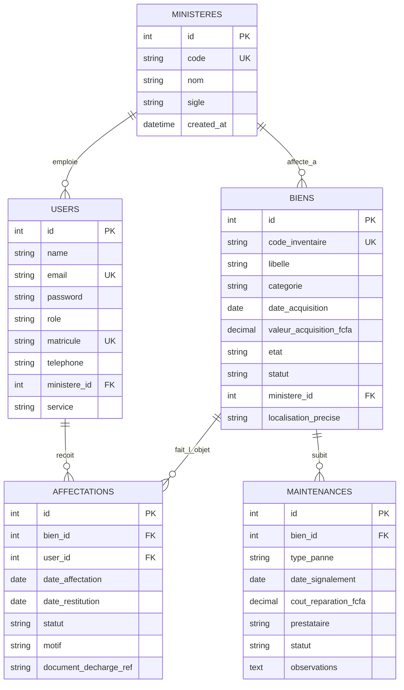

# GEST-PATRIMOINE — Système Intégré de Gestion du Patrimoine de l'État Togolais

<div align="center">


<br>

**Direction Générale du Patrimoine de l'État (DGPE)**  
*Ministère de l'Économie et des Finances — Lomé, République Togolaise*

</div>

---

## 🏛️ 1. Présentation & Contexte Institutionnel

**GEST-PATRIMOINE** est une plateforme web moderne et conteneurisée conçue pour l'administration publique togolaise. Elle assure le recensement, la traçabilité physique, la valorisation comptable en Francs CFA (FCFA) et le suivi de maintenance de l'ensemble du parc mobilier et immobilier de l'État Togolais (ministères, directions générales, institutions publiques et préfectures).

### Objectifs Stratégiques :
- 🏷️ **Immatriculation Nationale Unique** : Attribution automatique d'un code inventaire normalisé (`GPE-XXXXXX`) à chaque immobilisation.
- 🔄 **Traçabilité des Affectations** : Enregistrement des décharges de matériel remis aux fonctionnaires et suivi des mouvements inter-ministériels.
- 🛠️ **Gestion Préventive & Curative des Pannes** : Gestion des tickets d'intervention, prestataires agréés togolais (STBTP Lomé, CFAO Motors Togo) et facturation en FCFA.
- 🖨️ **Certification & Sceau Officiel de l'État** : Génération de rapports globaux certifiés conformes, intégrant le nom de l'autorité signataire, le scan de sa signature manuscrite et le cachet officiel circulaire de la République Togolaise.

---

## 📐 2. Normalisation des Données (MCD, MLD & Formes Normales)

La modélisation de la base de données a été menée selon la méthode **Merise** et respecte scrupuleusement les règles de normalisation relationnelle de Codd afin d'éliminer toute redondance et anomalie de mise à jour.



### Justification des Formes Normales :

1. **Première Forme Normale (1FN) — Atomicité & Unicité** :
   - Tous les attributs contiennent des valeurs scalaires atomiques et indivisibles (ex : téléphone au format `+228 XX XX XX XX`, devise monétaire unitaire `FCFA`, dates au format ISO).
   - Chaque entité possède une clé primaire unique (`id`, `matricule`, `code_inventaire`).

2. **Deuxième Forme Normale (2FN) — Dépendance Fonctionnelle Totale** :
   - La relation est en 1FN et tous les attributs non-clé dépendent pleinement et exclusivement de la totalité de la clé primaire.
   - Les clés primaires étant simples (mono-attributaires), aucune dépendance partielle n'est possible.

3. **Troisième Forme Normale (3FN) — Absence de Dépendance Transitive** :
   - La relation est en 2FN et aucun attribut non-clé ne dépend d'un autre attribut non-clé.
   - *Exemple concret d'application* : Les informations ministérielles (`nom`, `sigle`) ne sont pas stockées dans la table `users` ni dans la table `biens`, mais isolées dans l'entité `ministeres` et reliées par la clé étrangère `ministere_id`. Modifier le nom d'un ministère ne nécessite donc qu'une seule mise à jour sans risque d'incohérence.

---

## 🏗️ 3. Architecture Microservices ("Database-per-Service")

L'application est découpée en microservices découplés communiquant via HTTP/REST, chacun possédant sa propre base de données étanche :

```
                                  [ NAVIGATEUR CLIENT / MOBILE ]
                                                │
                                                ▼ HTTP (Port 8080)
                                  ┌───────────────────────────┐
                                  │   API GATEWAY & FRONTEND  │ (gateway-frontend)
                                  │  Sessions, Vues, Rapports │
                                  └─────────────┬─────────────┘
                                                │
                      ┌─────────────────────────┼─────────────────────────┐
                      ▼                         ▼                         ▼
             ┌─────────────────┐       ┌─────────────────┐       ┌─────────────────┐
             │  AUTH SERVICE   │       │ PATRIMOINE SVC  │       │ AFFECTATION SVC │
             │   (Port 8001)   │       │   (Port 8002)   │       │   (Port 8003)   │
             └────────┬────────┘       └────────┬────────┘       └────────┬────────┘
                      │                         │                         │
                      ▼                         ▼                         ▼
               [ auth_db ]               [ patrimoine_db ]         [ affectation_db ]
             Users & Ministères           Biens & Inventaire       Décharges & Pannes
```

### Isolation des 3 Bases de Données :
- **`auth_db`** : Gère les comptes des fonctionnaires, l'annuaire des ministères togolais et les rôles (`superadmin`, `gestionnaire`, `agent`).
- **`patrimoine_db`** : Registre central des biens publics, calculs comptables, statuts d'usure et amortissements.
- **`affectation_db`** : Traçabilité des bons de décharge, fonctionnaires détenteurs et tickets de maintenance.

> [!NOTE]
> **Double mode de fonctionnement transparent :**
> - **Mode Docker** : Les 3 bases s'exécutent sur un cluster **PostgreSQL 16**.
> - **Mode Standalone / Démo** : Si Docker n'est pas actif, un fallback transparent utilise **3 bases SQLite isolées** (`auth.sqlite`, `patrimoine.sqlite`, `affectation.sqlite`) sans nécessiter aucune configuration préalable.

---

## ✨ 4. Fonctionnalités Majeures Implémentées

| Fonctionnalité | Description & Rendu |
| :--- | :--- |
| **Opérations CRUD Complètes** | Actions **Voir** (fiche d'inventaire détaillée), **Modifier** (mise à jour en temps réel) et **Supprimer** (avec confirmation sécurisée) sur tous les modules. |
| **Recherche Instantanée** | Filtrage en temps réel dès la première frappe au clavier (*live-filtering* JS) + recherche multi-colonnes SQL étendue à 8 attributs. Bouton d'effacement rapide `×`. |
| **Actualisation Automatique** | Minuteur de synchronisation périodique **`Sync Auto: 30s`** dans l'en-tête, avec mise en pause automatique lorsqu'une saisie ou un formulaire modal est actif. |
| **Alertes Fluides Auto-Dismiss** | Les bandeaux de notification disparaissent automatiquement après 3,2 secondes avec barre de progression animée et nettoyage immédiat de l'URL (`history.replaceState`). |
| **Cachet & Sceau d'État** | Téléversement d'image (PNG détouré transparent, SVG, JPG) avec aperçu immédiat et apposition du sceau officiel circulaire de la DGPE Togo. |
| **Signature Manuscrite** | Saisie personnalisée du **Nom de l'Autorité Signataire au-dessus de la signature**, import de scan de signature manuscrite ou génération d'une calligraphie administrative. |
| **Édition & Export PDF Certifié** | Modèle conforme aux décrets administratifs togolais avec totalisation comptable en FCFA, mise en page officielle et zone d'impression haute fidélité. |

---

## ☁️ 5. Déploiement Cloud Gratuit (Hébergement en 1 Clic sur Render.com)

Le projet intègre un fichier [`render.yaml`](render.yaml) et un [`Dockerfile`](Dockerfile) universel pré-configurés pour être hébergés gratuitement sur **Render.com** :

### Procédure de déploiement gratuit (3 minutes) :
1. Créez un compte gratuit sur [Render.com](https://render.com).
2. Cliquez sur **`New +`** puis sélectionnez **`Web Service`**.
3. Liez votre dépôt GitHub : `https://github.com/<votre-nom>/GEST-PATRIMOINE`.
4. Sélectionnez :
   - **Environment** : `Docker` *(Render détectera automatiquement le `Dockerfile` à la racine)*.
   - **Plan** : `Free` *(100% gratuit)*.
   - **Region** : `Frankfurt (EU Central)` *(recommandé pour une latence minimale)*.
5. Cliquez sur **`Create Web Service`**.
6. En moins de 2 minutes, votre plateforme est accessible en ligne avec HTTPS gratuit :  
   `https://gestion-patrimoine-etat-anqt.onrender.com`

---

## 💻 6. Démarrage en Environnement Local

### Méthode A : Démarrage Rapide en 1 Clic (Windows)
Double-cliquez simplement sur le fichier :
```text
start-local.bat
```
L'application démarre immédiatement sur **`http://localhost:8080`**.

### Méthode B : Lancement Manuel avec PHP CLI
Dans le dossier du projet, lancez :
```bash
php -S 127.0.0.1:8080 -t gateway-frontend/public
```
Puis ouvrez [http://localhost:8080](http://localhost:8080) dans votre navigateur.

### Méthode C : Lancement avec Conteneurs Docker
```bash
docker compose up -d
```
Les conteneurs démarrent avec les ports :
- **Frontend / Gateway** : `8080`
- **Auth Service** : `8001`
- **Patrimoine Service** : `8002`
- **Affectation Service** : `8003`
- **PostgreSQL 16** : `5432`

---

## 🔐 7. Comptes & Identifiants de Démonstration

L'authentification est souple et moderne : la connexion est possible indifféremment par **Email**, par **Matricule** ou par **Nom officiel de l'agent**.  
Des boutons de connexion rapide en 1 clic sont également intégrés sur la mire de connexion (`/login`) :

| Rôle & Titre | Identifiant (Email / Matricule / Nom) | Mot de passe | Prérogatives & Ministère |
| :--- | :--- | :--- | :--- |
| **Super-Administrateur** | `admin@patrimoine.gouv.tg`<br>`MAT-TG-001`<br>`GOLI Amele Rolande` | `password123` | **Direction Générale du Patrimoine de l'État (DGPE Lomé)**<br>Accès universel, gestion complète des comptes administratifs, paramétrage du Sceau d'État et du Cachet Officiel circulaire |
| **Gestionnaire de Parc** | `gestionnaire@patrimoine.gouv.tg`<br>`MAT-TG-002`<br>`GODHOPE'S` | `password123` | **Direction du Matériel & Logistique (MEF Togo)**<br>Recensement des biens, enregistrement des affectations et décharges, suivi et clôture des tickets d'incidents techniques |
| **Agent Bénéficiaire** | `agent@patrimoine.gouv.tg`<br>`MAT-TG-003`<br>`MY ALL` | `password123` | **Direction de la Transformation Digitale (MENTD)**<br>Espace personnel restreint, consultation du matériel confié sous décharge, déclaration directe de pannes |
| **Auditeur / Inspecteur** | `auditeur@patrimoine.gouv.tg`<br>`MAT-TG-004`<br>`Komi AMEGAN` | `password123` | **Inspection Générale des Finances (IGF Lomé)**<br>Supervision générale en lecture seule certifiée, tableaux de bord de valorisation, registres exhaustifs et rapports financiers |

> **Sécurité des Mots de Passe** : Chaque utilisateur dispose d'un mot de passe propre (hachage sécurisé BCrypt). Le Super-Administrateur peut modifier les noms, rôles et mots de passe individuels à tout moment depuis le module *Annuaire des Agents & Ministères* (`/utilisateurs`).

---

## 📂 8. Structure du Code Source

```text
GEST-PATRIMOINE/
├── auth-service/                  # Microservice Authentification & Ministères (Port 8001)
│   ├── src/Database.php           # Connexion PostgreSQL & Fallback SQLite
│   ├── src/Controllers/           # Contrôleur REST AuthController
│   └── public/index.php           # Point d'entrée de l'API
│
├── patrimoine-service/            # Microservice Biens & Inventaire (Port 8002)
│   ├── src/Database.php           # Connexion PostgreSQL & Fallback SQLite
│   ├── src/Controllers/           # Contrôleur REST PatrimoineController (CRUD + Recherche)
│   └── public/index.php           # Point d'entrée de l'API
│
├── affectation-service/           # Microservice Affectations & Maintenances (Port 8003)
│   ├── src/Database.php           # Connexion PostgreSQL & Fallback SQLite
│   ├── src/Controllers/           # Contrôleur REST AffectationController
│   └── public/index.php           # Point d'entrée de l'API
│
├── gateway-frontend/              # API Gateway & Interface Web Publique (Port 8080)
│   ├── src/ServicesClient.php     # Client cURL inter-services & Proxy interne
│   ├── views/                     # Vues HTML/PHP (Dashboard, Biens, Affectations, Cachet, Rapports)
│   ├── public/css/app.css         # Design System institutionnel & impression
│   ├── public/uploads/            # Cachet officiel (SVG/PNG) & paramètres signataire (JSON)
│   └── public/index.php           # Routeur principal de la Gateway
│
├── docker/
│   ├── Dockerfile.service         # Image Docker PHP pour microservices
│   └── init-databases.sql         # Script d'initialisation multi-bases PostgreSQL
│
├── docs/                          # Dossier des livrables documentaires
│   ├── cahier-des-charges.md      # Spécifications fonctionnelles & besoins
│   ├── conception-uml.md          # 6 Diagrammes UML (Mermaid)
│   ├── fiche-technique.md         # Fiche d'architecture & sécurité
│   ├── proposition-financiere.md  # Devis chiffré en FCFA
│   ├── guide-utilisation.md       # Manuel d'utilisation détaillé
│   ├── design-figma-specifications.md # Charte graphique & UI
│   └── guide-soutenance-orale.md  # Guide de préparation à la soutenance
│
├── Dockerfile                     # Dockerfile racine universel pour déploiement Cloud
├── render.yaml                    # Manifeste d'automatisation Render Cloud
├── docker-compose.yml             # Orchestration complète du cluster local
├── start-local.bat                # Lancement local instantané
└── README.md                      # Présentation et normalisation du projet
```

---

## 📜 9. Licence & Propriété Intellectuelle

Projet conçu et développé dans le cadre du référentiel **Développeur Web & Web Mobile / Full Stack**.  
Mentions légales : © Direction Générale du Patrimoine de l'État — République Togolaise.
