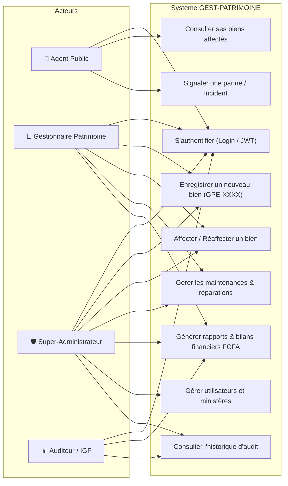
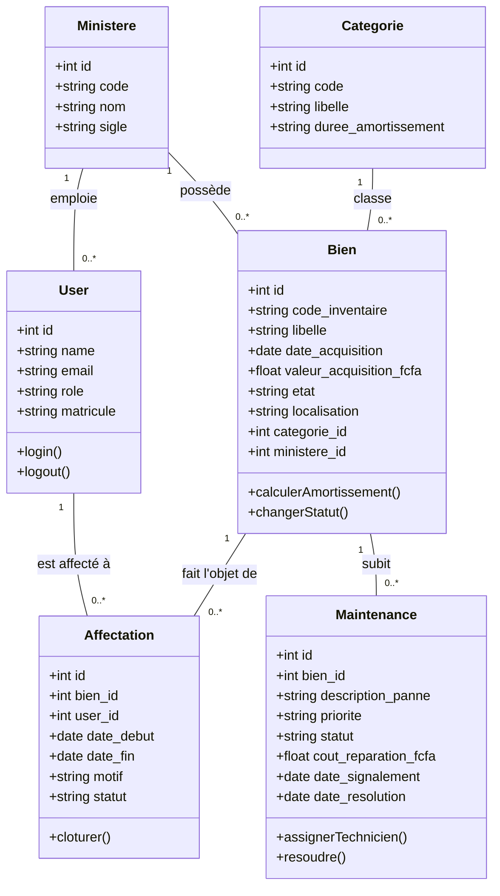
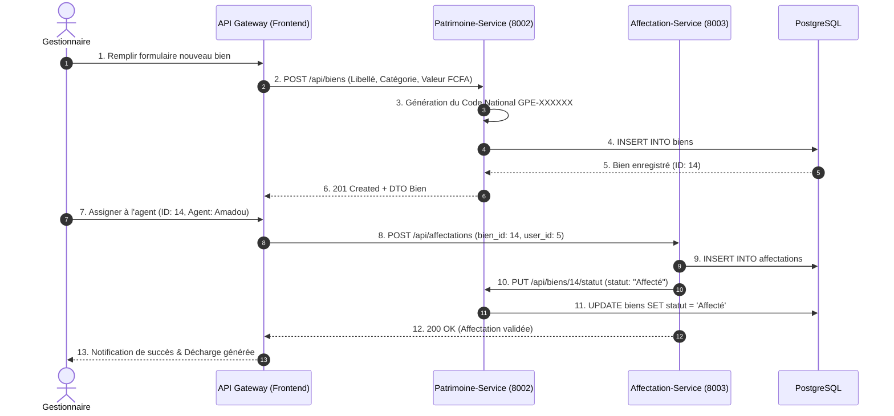
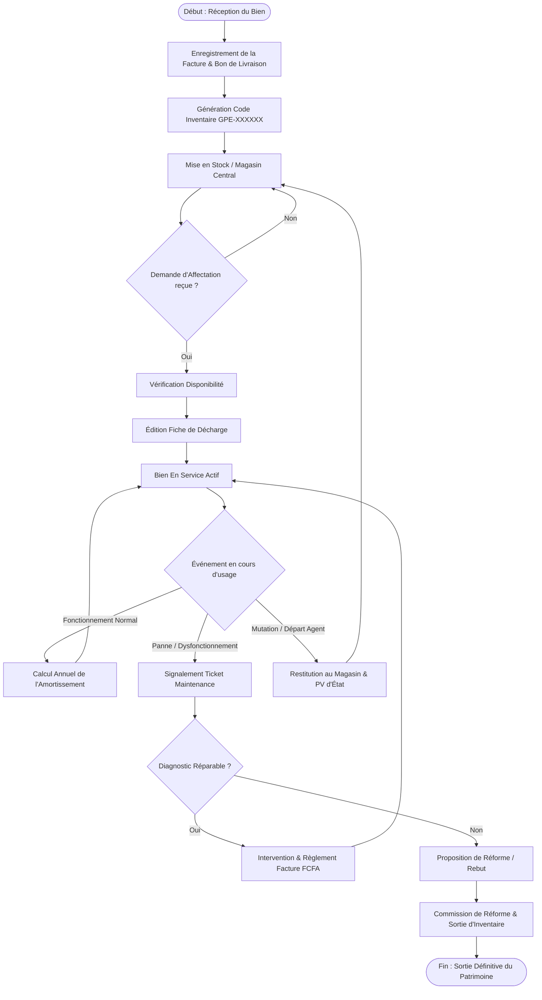
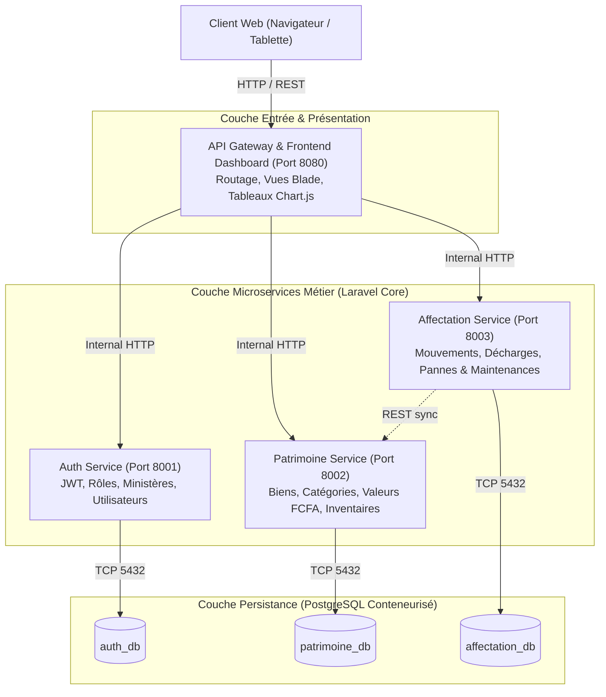
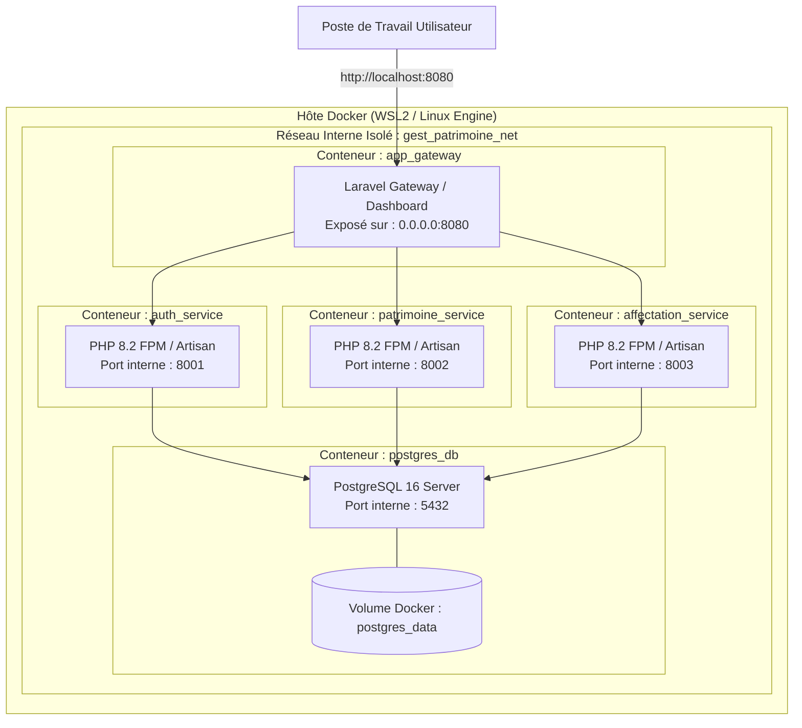

# MODÉLISATION & CONCEPTION UML DU PROJET
## GEST-PATRIMOINE — Architecture Logicielle & Modèles Conceptuels

Ce document rassemble l'ensemble des diagrammes UML exigés pour la soutenance professionnelle et l'évaluation de la solution.

---

## 1. Diagramme de Cas d'Utilisation (Use Case Diagram)

Ce diagramme illustre les interactions des différents acteurs avec le système GEST-PATRIMOINE.

---

## 2. Diagramme de Classes Métier (Class Diagram)

Ce diagramme représente la structure relationnelle des données du domaine du patrimoine.

---

## 3. Diagramme de Séquence : Enregistrement et Affectation d'un Bien

Ce diagramme décrit la chaîne des échanges asynchrones entre l'utilisateur, l'API Gateway et les microservices.

---

## 4. Diagramme d'Activité : Cycle de Vie d'un Bien de l'État

---

## 5. Diagramme de Composants : Architecture Microservices

---

## 6. Diagramme de Déploiement : Conteneurisation Docker

