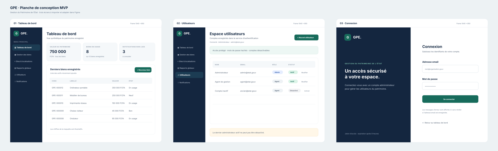

# Guide d’utilisation — GPE

**Version :** 1.0 · **Date :** 13 novembre 2026 · **Application :** démo locale GPE



## 1. Accéder à l’application

1. Démarrer Docker Desktop.
2. Dans PowerShell, se placer dans le dépôt puis vérifier les conteneurs :

   ```powershell
   docker compose ps
   ```

3. Ouvrir [http://localhost:8080](http://localhost:8080) dans le navigateur.
4. Les écrans et les données sont ceux de l’environnement local PostgreSQL.

## 2. Créer le premier compte administrateur

Depuis le dossier du dépôt :

```powershell
docker exec -it -w /var/www gpe-auth php artisan admin:create
```

La commande demande le nom, l’adresse email, puis un mot de passe d’au moins 12 caractères à saisir et confirmer. Aucun mot de passe par défaut n’est fourni.

## 3. Se connecter et se déconnecter

1. Ouvrir [http://localhost:8080/connexion](http://localhost:8080/connexion).
2. Saisir l’email et le mot de passe d’un compte administrateur actif.
3. En cas d’échec, vérifier la saisie et l’état du compte ; le message n’indique pas si un email existe.
4. Pour fermer la session, utiliser **Se déconnecter** depuis la page Utilisateurs.

Le jeton API expire huit heures après sa création. La session web expire après 120 minutes d’inactivité par défaut (valeur configurable avec `SESSION_LIFETIME`). La session web et le jeton sont conservés côté serveur ; le navigateur ne reçoit pas le jeton API.

## 4. Gérer les comptes utilisateurs

Ouvrir **Utilisateurs** dans le menu latéral. La liste provient du service `auth-service` et de PostgreSQL.

### Créer un compte

1. Cliquer sur **Nouvel utilisateur**.
2. Renseigner le nom, une adresse email unique et le rôle (`Agent` ou `Administrateur`).
3. Saisir un mot de passe d’au moins 12 caractères et sa confirmation.
4. Cliquer sur **Enregistrer**.

### Modifier un compte

1. Cliquer sur **Modifier** dans la ligne correspondante.
2. Modifier le nom, l’email ou le rôle.
3. Pour remplacer le mot de passe, remplir les deux champs de mot de passe ; pour le conserver, les laisser vides.
4. Enregistrer les changements.

### Activer ou désactiver

1. Cliquer sur **Désactiver** ou **Activer**.
2. Confirmer l’action.
3. Le compte désactivé ne peut plus ouvrir de session ; ses jetons actifs sont révoqués.

Le dernier administrateur actif ne peut pas être désactivé ou rétrogradé. Un administrateur ne peut pas désactiver son propre compte ni retirer son propre rôle.

> Dans le MVP, les comptes `agent` sont administrables mais la connexion et les écrans dédiés aux agents ne sont pas encore ouverts.

## 5. Gérer les biens

Ouvrir **Gestion des biens**. Le tableau permet de parcourir les biens enregistrés et leurs codes.

### Ajouter un bien

1. Cliquer sur **Nouveau bien**.
2. Saisir le libellé, l’état, la date d’acquisition et la valeur en FCFA.
3. Cliquer sur **Enregistrer**.
4. Le serveur attribue un code `GPE-xxxxxx` unique.

Dans cette version, la catégorie est automatiquement associée à l’identifiant de catégorie `1` ; la sélection de catégorie depuis le formulaire est une amélioration à réaliser. Les états disponibles dans le formulaire sont **Neuf**, **En usage** et **Réformé**.

### Consulter, modifier et supprimer

- **Voir** ouvre les détails du bien.
- **Modifier** permet de changer le libellé, l’état et la valeur.
- **Supprimer** demande une confirmation puis retire le bien du registre. Cette action ne dispose pas de corbeille dans le MVP.

Une requête de suppression répétée sur un bien déjà supprimé renvoie un succès sans supprimer un autre enregistrement.

## 6. Gérer les sites

Ouvrir **Sites & Localisations**.

1. **Nouveau site** ouvre le formulaire.
2. Le code du site est attribué automatiquement (SITE-02, SITE-03, etc.). Renseigner le nom ; la ville et la région sont facultatives.
3. Enregistrer, puis utiliser les actions de ligne pour modifier ou supprimer un site.

Les écrans de transfert et d’affectation complète d’un bien à un site ne font pas partie du parcours web livré.

## 7. Notifications

- Les notifications sont conservées dans PostgreSQL et restent accessibles depuis **Notifications**.
- Le tableau de bord montre un aperçu des nouvelles notifications.
- **Marquer les nouvelles comme lues** enregistre leur état de lecture.
- Certaines opérations sur les biens créent une notification : ajout, passage à l’état réformé et suppression.

## 8. Rapports

Ouvrir **Rapports globaux** pour consulter les totaux et répartitions disponibles. L’action d’impression du navigateur permet de produire une version papier ou PDF via la boîte de dialogue d’impression. Le MVP ne fournit pas de génération de fichier CSV.

## 9. Dépannage

| Symptôme | Vérification / action |
|---|---|
| Page inaccessible | `docker compose ps`, puis `docker compose logs --tail 100 gateway patrimoine-service` |
| Connexion refusée ou service auth indisponible | Vérifier `docker compose logs --tail 100 auth-service` et `AUTH_SERVICE_URL` dans `services/patrimoine/.env` |
| `Could not open input file: artisan` | Ajouter `-w /var/www` à `docker exec` pour les commandes Artisan |
| Styles absents après un changement | Depuis `services/patrimoine` lancer `npm run build`, puis recharger avec `Ctrl+F5` |
| Session expirée | Se reconnecter ; le jeton API expire après huit heures |
| Données locales indisponibles après arrêt | Utiliser `docker compose down` pour arrêter ; ne pas ajouter `-v`, qui effacerait le volume PostgreSQL |

## 10. Limites d’utilisation

Cette version est destinée à une démonstration. Les routes métiers des biens et des sites doivent être protégées avant publication sur Internet. Éviter d’y inscrire des données sensibles ou réelles de l’État. Le stockage local ne remplace pas une politique de sauvegarde.
